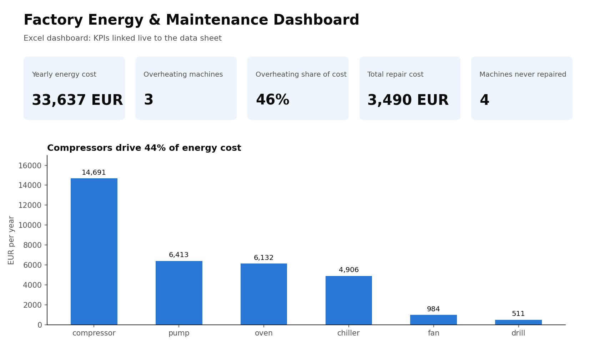

# 📗 Factory Energy & Maintenance Dashboard (Excel)

**One sheet that tells a plant manager, in 10 seconds, where energy and maintenance money goes.**

Built in **Microsoft Excel** with formulas, a pivot table, XLOOKUP, conditional formatting and a KPI dashboard linked live to the data.

*Preview rendered from the workbook's KPIs and chart. Open `Factory_Excel_Dashboard.xlsx` to see the live version.*

---

## 🔑 Key findings

| KPI | Value |
|---|---|
| Yearly energy cost | **33,637 EUR** |
| Biggest cost driver | **Compressors: 44%** of energy cost |
| Overheating machines (> 90 °C) | **3** |
| Their share of energy cost | **46%** |
| Total repair cost | **3,490 EUR** |
| Machines never repaired | **4** |

---

## 🛠️ What I built (Excel skills)

| Sheet | Feature | Example formula / tool |
|---|---|---|
| `machines` | Calculated columns | `=C2*D2` (daily kWh) |
| | Locked price cell, so one change updates all costs | `=F2*365*$I$2` |
| | Automatic status flag | `=IF(E2>90,"Overheating","Ok")` |
| | Lookup from a second table (like a SQL LEFT JOIN) | `=XLOOKUP(A2,$K$2:$K$7,$L$2:$L$7,0)` |
| | Summary statistics | `SUM`, `AVERAGE`, `MEDIAN`, `MAX`, `MIN` |
| | Conditional counts and sums | `COUNTIF`, `SUMIF` |
| | Conditional formatting | 🔴 temperatures > 90 °C, 📊 data bars on repair cost |
| `pivot sheet` | Pivot table (like GROUP BY) | yearly cost per machine type, sorted, with % share |
| | Column chart | title states the finding, labelled axis |
| `Dashboard` | 5 KPI tiles linked to the data sheet | `=SUMIF(machines!H2:H11,"Overheating",machines!G2:G11)/A4` |

---

## 📁 Files

| File | Content |
|---|---|
| `Factory_Excel_Dashboard.xlsx` | the workbook: data, formulas, pivot table, chart and dashboard |
| `dashboard_preview.png` | preview image of the dashboard |

**Data:** a small sample dataset created for practice (10 machines, electricity price 0.35 EUR/kWh, 365 operating days). The same factory is analysed with Python, SQL and statistics in my other projects.

**Note:** `XLOOKUP` needs Excel 2021 / Microsoft 365. In older versions, use `=IFERROR(VLOOKUP(A2,$K$2:$L$7,2,FALSE),0)`.

---

## 👤 About

**Ayush Ramtekkar**: M.Sc. student in AI / Data Science & Digital Business (Gisma, Berlin) with a B.E. in Mechanical Engineering. Looking for a **Werkstudent role in data analytics**, ideally in energy, cleantech or manufacturing.

📂 More projects:
- [Factory Energy Analysis (Python & pandas)](https://github.com/ayushramtekkar/Factory_Energy_Analysis)
- [Factory Maintenance Analysis (SQL)](https://github.com/ayushramtekkar/Factory_maintenance_SQL)
- [Factory Statistics Analysis (Python & statistics)](https://github.com/ayushramtekkar/Factory_Statistics_Analysis)
